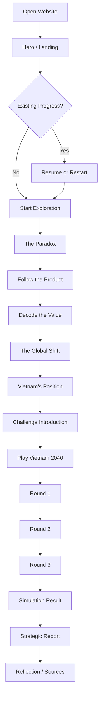
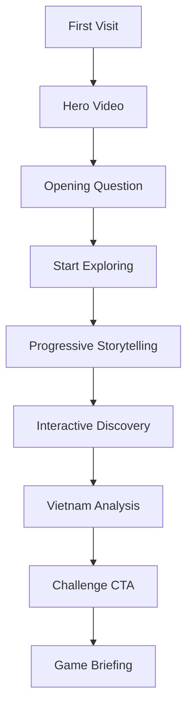
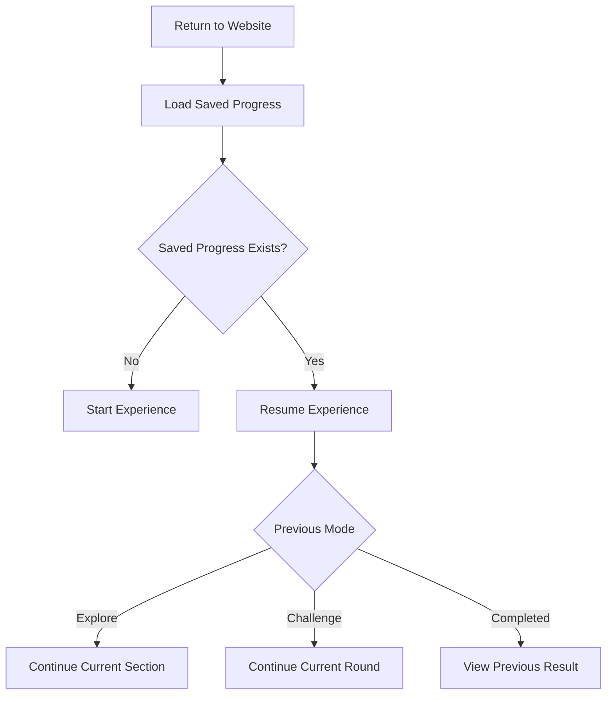
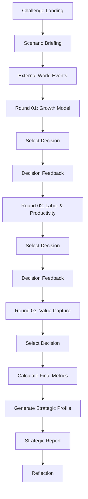

# INFORMATION ARCHITECTURE & USER FLOW
## THE VALUE SHIFT

**Version:** 1.0  
**Product type:** Immersive Digital Learning Experience  
**Platform:** Interactive Web Application  
**Primary experience:** Scrollytelling + Interactive Exploration + Strategy Simulation

---

# 1. PRODUCT EXPERIENCE PRINCIPLES

## 1.1. Core user journey

THE VALUE SHIFT được thiết kế theo hành trình:

**Curiosity → Exploration → Understanding → Analysis → Decision → Reflection**

Người dùng bắt đầu bằng một nghịch lý kinh tế, lần theo hành trình của sản phẩm, khám phá cơ chế tạo ra giá trị, tìm hiểu chuỗi giá trị toàn cầu, phân tích vị thế Việt Nam và cuối cùng đưa ra quyết định chiến lược.

## 1.2. Navigation philosophy

Sử dụng mô hình **Guided Linear Exploration with Free Navigation**.

Ba nguyên tắc:

1. Guided: Website đề xuất một hành trình học tập theo thứ tự.
2. Flexible: Người dùng có thể nhảy đến bất kỳ section nào.
3. Persistent: Tiến độ được lưu lại khi người dùng rời trang hoặc refresh.

Không thiết kế website giống slide presentation với các nút Next/Previous là phương thức điều hướng duy nhất.

## 1.3. User modes

Có hai chế độ sử dụng:

**Explore Mode**
- Trải nghiệm đầy đủ câu chuyện.
- Được khuyến khích theo thứ tự.
- Có thể bỏ qua hoặc quay lại section.
- Mặc định mở ra khi truy cập website.

**Challenge Mode**
- Người dùng tham gia mô phỏng Vietnam 2040.
- Có thể bắt đầu sau khi hoàn thành phần khám phá.
- Có thể vào trực tiếp nếu người dùng chủ động chọn.
- Luôn có phần giải thích ngắn để cung cấp đủ bối cảnh trước khi ra quyết định.

---

# 2. INFORMATION ARCHITECTURE

## 2.1. Sitemap

```text
THE VALUE SHIFT
│
├── HOME / LANDING
│   ├── Hero
│   ├── Opening Narrative
│   ├── Core Question
│   └── Start Exploration
│
├── EXPLORE
│   │
│   ├── 01. THE PARADOX
│   │   ├── Opening Video
│   │   ├── Core Question
│   │   └── Initial Interaction
│   │
│   ├── 02. FOLLOW THE PRODUCT
│   │   ├── Product Journey
│   │   ├── Value Chain Stages
│   │   └── Who Controls the Chain?
│   │
│   ├── 03. DECODE THE VALUE
│   │   ├── Commodity & Value
│   │   ├── Labor Power
│   │   ├── Surplus Value
│   │   └── Working Day Simulator
│   │
│   ├── 04. THE GLOBAL SHIFT
│   │   ├── Global Value Chain Map
│   │   ├── Value Distribution
│   │   └── Global Chain Governance
│   │
│   └── 05. VIETNAM'S POSITION
│       ├── Export Performance
│       ├── FDI & Domestic Enterprises
│       ├── GVC Participation
│       ├── Technology & Productivity
│       └── Vietnam's Opportunities
│
├── CHALLENGE
│   ├── Introduction
│   ├── Scenario Briefing
│   ├── Round 01: Growth Model
│   ├── Round 02: Labor & Productivity
│   ├── Round 03: Value Capture
│   ├── Simulation Result
│   └── Strategic Report
│
├── ABOUT / SOURCES
│   ├── Learning Objectives
│   ├── Methodology
│   ├── Data Sources
│   ├── Academic Notes
│   └── Credits
│
└── GLOBAL UI
    ├── Main Navigation
    ├── Progress Indicator
    ├── Section Navigator
    ├── Deep Dive Panel
    ├── Source Tooltip
    ├── Settings / Reduced Motion
    └── Resume Experience
```

## 2.2. URL structure

Sử dụng URL rõ ràng, hỗ trợ deep linking và truy cập trực tiếp từng section.

```text
/
├── /explore
│   ├── /explore/the-paradox
│   ├── /explore/follow-the-product
│   ├── /explore/decode-the-value
│   ├── /explore/the-global-shift
│   └── /explore/vietnams-position
│
├── /challenge
│   ├── /challenge/briefing
│   ├── /challenge/round-1
│   ├── /challenge/round-2
│   ├── /challenge/round-3
│   └── /challenge/result
│
└── /about
    ├── /about/methodology
    └── /about/sources
```

MVP có thể triển khai toàn bộ Explore trên một route với các anchor section để tận dụng Scrollytelling.

Các route con vẫn nên được hỗ trợ bằng hash hoặc routing logic để người dùng có thể truy cập trực tiếp, ví dụ:

`/explore#decode-the-value`

Không bắt buộc mỗi section phải là một page riêng biệt.

---

# 3. GLOBAL NAVIGATION STRUCTURE

## 3.1. Main navigation

Navigation cần tối giản để không cạnh tranh với nội dung chính.

```text
┌──────────────────────────────────────────────────────┐
│ THE VALUE SHIFT     EXPLORE     CHALLENGE     ABOUT   │
│                                      [START / RESUME] │
└──────────────────────────────────────────────────────┘
```

### Navigation items

| Item | Action |
|---|---|
| Logo | Return to Home |
| Explore | Open exploration journey |
| Challenge | Open Vietnam 2040 |
| About | Open methodology and sources |
| Start / Resume | Start or continue experience |

### Navigation behavior

- Navigation trong Hero có thể trong suốt.
- Khi cuộn xuống, navigation chuyển thành compact sticky header.
- Khi ở Explore, hiển thị progress indicator.
- Khi vào Challenge, hiển thị round progress.
- Không hiển thị quá nhiều menu cùng lúc.

## 3.2. Section Navigator

Một thanh điều hướng nhỏ bên cạnh màn hình hoặc trong sticky header.

```text
01 THE PARADOX
02 FOLLOW THE PRODUCT
03 DECODE THE VALUE
04 THE GLOBAL SHIFT
05 VIETNAM'S POSITION
06 THE CHALLENGE
```

Behavior:
- Highlight section hiện tại.
- Click để scroll đến section tương ứng.
- Các section chưa khám phá vẫn có thể truy cập.
- Không dùng màu sắc để tạo cảm giác khóa nội dung nếu không thực sự có điều kiện khóa.

## 3.3. Progress indicator

Hiển thị hai loại tiến độ:

**Exploration Progress**
- Sections visited.
- Sections completed.
- Current position.

**Challenge Progress**
- Current round.
- Completed decisions.
- Result generated or not.

Không gộp hai loại tiến độ thành một phần trăm duy nhất vì chúng đại diện cho hai trải nghiệm khác nhau.

---

# 4. DETAILED USER FLOW

## 4.1. Primary user flow

Đây là hành trình được ưu tiên cho người dùng mới.



### Expected experience

- Người dùng không cần đăng ký tài khoản.
- Người dùng không cần nhập thông tin cá nhân.
- Progress được lưu local trên trình duyệt.
- Có thể quay lại nội dung đã xem.
- Kết quả game được giữ lại sau khi refresh.

## 4.2. First-time visitor flow



Mục tiêu:
- Tạo tò mò ngay trong 5–10 giây đầu.
- Người dùng hiểu website nói về vấn đề gì trước khi học lý thuyết.
- Không yêu cầu người dùng đọc dài hoặc đăng nhập trước khi trải nghiệm.

## 4.3. Returning visitor flow



Người dùng có thể:
- Resume.
- Restart.
- Xem lại kết quả cũ.
- Tiếp tục từ section hoặc round cuối cùng.

Restart cần có confirmation nếu sẽ ghi đè tiến độ hiện tại.

---

# 5. SECTION-LEVEL USER FLOW

# 5.1. THE PARADOX

**Goal:** Tạo sự tò mò và đưa ra câu hỏi trung tâm.

```text
Hero Video
   ↓
Opening Statement
   ↓
Core Question
   ↓
Initial Poll / Prediction
   ↓
Transition to Product Journey
```

### Interactions

- Video autoplay muted.
- Không tự động phát âm thanh.
- Có nút Play/Pause.
- Có subtitle/caption.
- Nếu video không tải được, dùng poster image.
- Poll cho phép chọn một câu trả lời.
- Có thể bỏ qua poll.

### Completion condition

Section được xem là completed khi:
- Người dùng xem hoặc bỏ qua phần opening.
- Người dùng đi qua phần câu hỏi trung tâm.

Không bắt buộc phải trả lời poll.

---

# 5.2. FOLLOW THE PRODUCT

**Goal:** Giúp người dùng hiểu cấu trúc Global Value Chain.

```text
Product Introduction
       ↓
Product Visualization
       ↓
Select a Production Stage
       ↓
View Stage Details
       ↓
Explore Ownership / Capabilities
       ↓
Chain Summary
       ↓
Next Section
```

### Interactions

- Click node để xem thông tin.
- Hover node để xem quick insight.
- Có thể chuyển qua lại giữa các công đoạn.
- Có thể chọn View Full Chain.
- Deep Dive hiển thị thông tin mở rộng.
- Có nút Reset Visualization.

### Completion condition

Người dùng đã:
- Xem tối thiểu một công đoạn.
- Hoặc chọn Skip Exploration.

Không yêu cầu người dùng click tất cả các node.

---

# 5.3. DECODE THE VALUE

**Goal:** Giải thích cơ chế giá trị thặng dư.

```text
Introduce Commodity
       ↓
Explain Labor Power
       ↓
Introduce Working Day
       ↓
Working Day Simulator
       ↓
Explain Surplus Value
       ↓
Formula / Deep Dive
       ↓
Next Section
```

### Interactions

Working Day Simulator:

Input:
- Total working hours.
- Necessary labor time.

Output:
- Surplus labor time.
- Surplus value rate.
- Visual representation of necessary/surplus labor.

Validation:
- Total working hours must be greater than zero.
- Necessary labor time must be greater than zero.
- Necessary labor time must be smaller than total working hours.

Formula:

`m' = (surplus labor time / necessary labor time) × 100%`

Đây là mô hình trực quan hóa lý luận, không phải công cụ tính toán lương thực tế.

### Completion condition

Người dùng đã xem phần giải thích giá trị thặng dư và tương tác với simulator hoặc chọn Skip.

---

# 5.4. THE GLOBAL SHIFT

**Goal:** Hiểu sự phân bố các hoạt động kinh tế trong chuỗi giá trị toàn cầu.

```text
Global Context
      ↓
Interactive World Map
      ↓
Select a Region / Country
      ↓
View GVC Role
      ↓
Value Distribution Visualization
      ↓
Explore Chain Governance
      ↓
Next Section
```

### Interactions

- Chọn khu vực hoặc quốc gia trên bản đồ.
- Hiển thị dữ liệu và thông tin theo quốc gia.
- Có filter theo ngành.
- Có thể chuyển giữa:
  - Production locations.
  - Value-added origins.
  - Ownership / headquarters.
  - Consumer markets.
- Click Sankey node để xem thông tin.

### Data behavior

- Chỉ hiển thị dữ liệu có nguồn xác định.
- Không trộn dữ liệu khác năm mà không ghi chú.
- Nếu chưa có dữ liệu cho bộ lọc, hiển thị trạng thái No Data Available.
- Phân biệt actual data và illustrative data.

### Completion condition

Người dùng đã tương tác với bản đồ hoặc biểu đồ, hoặc chọn Skip.

---

# 5.5. VIETNAM'S POSITION

**Goal:** Liên hệ lý thuyết với tình hình kinh tế Việt Nam.

```text
Vietnam Introduction
       ↓
Export Performance
       ↓
FDI vs Domestic Sector
       ↓
Domestic GVC Participation
       ↓
Technology / Productivity
       ↓
Structural Challenges
       ↓
Growth Opportunities
       ↓
Challenge CTA
```

### Interactions

- Chuyển đổi giữa các indicator.
- Hover/click chart để xem giá trị.
- Click Source để xem nguồn.
- Có thể chuyển giữa năm hoặc ngành khi dataset hỗ trợ.
- Expand Deep Dive để xem giải thích.

### Completion condition

Người dùng đã xem các insight chính của Vietnam Analysis.

Không yêu cầu xem toàn bộ biểu đồ hoặc đọc toàn bộ nguồn.

---

# 6. CHALLENGE USER FLOW

## 6.1. Challenge entry

Người dùng có thể vào Challenge theo hai cách:

**Path A: Guided**
- Hoàn thành Explore.
- Click CTA: Enter Vietnam 2040.
- Chuyển đến Briefing.

**Path B: Direct**
- Click Challenge trên navigation.
- Hiển thị lời giới thiệu và kiến thức nền tảng ngắn.
- Người dùng có thể bắt đầu ngay.

Không khóa Challenge chỉ vì người dùng chưa hoàn thành Explore.

## 6.2. Game flow



## 6.3. Round structure

Mỗi round có cấu trúc:

1. Situation: bối cảnh kinh tế.
2. Challenge: vấn đề cần giải quyết.
3. Options: ba lựa chọn chiến lược.
4. Trade-offs: ưu và nhược điểm.
5. Decision: người dùng chọn một phương án.
6. Feedback: phản hồi ngay sau lựa chọn.
7. Continue: chuyển sang round tiếp theo.

### Decision behavior

- Mỗi round chỉ cho phép một lựa chọn chính.
- Người dùng có thể quay lại round trước khi hoàn thành game.
- Khi thay đổi quyết định ở round trước, phải tính lại các chỉ số và tác động ở những round tiếp theo.
- Không cho phép điểm số cũ bị cộng lặp khi người dùng đổi lựa chọn.
- Kết quả phải deterministic.

## 6.4. Game result

Result page gồm:

**A. Strategic Profile**
- Tên archetype.
- Mô tả chiến lược.
- Những đặc điểm nổi bật.

**B. Five Metrics**
- Domestic Value Capture.
- Technology Capability.
- Employment & Income.
- Economic Autonomy & Resilience.
- Sustainability.

**C. Decision Breakdown**
- Ba lựa chọn đã chọn.
- Ảnh hưởng của từng lựa chọn.
- Những đánh đổi phải chấp nhận.

**D. Alternative Strategy**
- Gợi ý lựa chọn khác có thể cải thiện điểm yếu.
- Giải thích sự đánh đổi đi kèm.

**E. Academic Reflection**
- Liên hệ với các khái niệm kinh tế chính trị.
- Nhấn mạnh đây là mô phỏng, không phải dự báo.

## 6.5. Result actions

- Replay Challenge.
- Review Decisions.
- Explore Weak Metrics.
- Return to Explore.
- View Sources.

Không cần tích hợp chia sẻ mạng xã hội trong MVP.

---

# 7. CONTENT ACCESS & PROGRESSION RULES

## 7.1. Section states

Mỗi section có một trong bốn trạng thái:

| State | Meaning |
|---|---|
| Not Started | Chưa bắt đầu |
| In Progress | Đang khám phá |
| Completed | Đã hoàn thành |
| Skipped | Người dùng chủ động bỏ qua |

Không sử dụng trạng thái Locked cho các section khám phá.

## 7.2. Challenge states

| State | Meaning |
|---|---|
| Not Started | Chưa bắt đầu |
| In Progress | Đã bắt đầu nhưng chưa hoàn thành |
| Completed | Đã có kết quả |
| Abandoned | Người dùng thoát khỏi game giữa chừng |

Nếu người dùng đóng trang giữa game, trạng thái phải được lưu thành In Progress thay vì mất dữ liệu.

## 7.3. Completion logic

Completion chỉ phản ánh việc người dùng đã đi qua trải nghiệm, không phản ánh mức độ hiểu kiến thức.

Không được diễn giải:
- Viewed = Understood.
- Completed = Mastered.
- Skipped = Failed.

Nếu muốn đánh giá kiến thức, cần một module assessment riêng. Không bắt buộc trong MVP.

---

# 8. PERSISTENCE & STATE MANAGEMENT

## 8.1. Storage strategy

MVP không cần backend hoặc tài khoản.

Dùng LocalStorage để lưu:

- Exploration progress.
- Current section.
- Section completion states.
- Challenge progress.
- Selected decisions.
- Final result.
- Last visited timestamp.
- User interface preferences nếu cần.

## 8.2. Suggested state schema

```ts
type SectionStatus =
  | "not-started"
  | "in-progress"
  | "completed"
  | "skipped";

type ChallengeStatus =
  | "not-started"
  | "in-progress"
  | "completed";

type ExperienceState = {
  version: number;

  explore: {
    currentSectionId: string;
    sections: Record<string, SectionStatus>;
  };

  challenge: {
    status: ChallengeStatus;
    currentRound: number;
    decisions: Record<string, string>;
    result: {
      metrics: {
        domesticValue: number;
        technology: number;
        employment: number;
        autonomy: number;
        sustainability: number;
      };
      archetype: string;
    } | null;
  };

  lastVisitedAt: string | null;
};
```

Đây là schema đề xuất; có thể điều chỉnh khi xây dựng Game Rules & Simulation Specification.

## 8.3. Persistence rules

- Save after every meaningful interaction.
- Save immediately after selecting a game decision.
- Restore state when the user returns.
- Validate stored state before loading.
- Handle missing or corrupted data gracefully.
- Use a version field for future schema migrations.
- Provide Restart Experience with confirmation.
- No personal information is required.

## 8.4. Storage failure

Nếu LocalStorage không khả dụng:

- Website vẫn phải hoạt động.
- Người dùng có thể trải nghiệm bình thường.
- Chỉ thông báo rằng tiến độ sẽ không được lưu.
- Không chặn trải nghiệm chính.

---

# 9. RESPONSIVE INFORMATION ARCHITECTURE

## Desktop

Primary layout:
- Sticky navigation.
- Section navigator.
- Large scrollytelling panels.
- Side-by-side visualization and explanation.
- Interactive map.
- Multi-column result dashboard.

## Tablet

- Thu gọn navigation.
- Giảm số cột.
- Biến sidebar thành compact navigator.
- Tối ưu tương tác cảm ứng.
- Không phụ thuộc hover để hiển thị nội dung quan trọng.

## Mobile

- Chuyển section navigator thành progress bar hoặc dropdown.
- Dùng vertical storytelling.
- Chart có thể chuyển sang dạng đơn giản hơn.
- Map có thể dùng full-screen panel.
- Decision cards xếp dọc.
- Deep Dive dùng bottom sheet hoặc expandable panel.
- Không yêu cầu người dùng hover.
- Không dùng animation scroll-pinning quá dài.

Mobile phải hỗ trợ toàn bộ chức năng cốt lõi, không chỉ là phiên bản thu nhỏ của desktop.

---

# 10. ERROR, EMPTY & EDGE STATES

Agent phải triển khai các trạng thái sau:

| Scenario | Expected behavior |
|---|---|
| Video unavailable | Show poster image and transcript |
| Chart data unavailable | Show No Data Available |
| Map fails to load | Show static fallback / summary |
| LocalStorage unavailable | Continue without persistence |
| Corrupted saved state | Reset invalid state safely |
| User refreshes during game | Restore current round and decisions |
| User changes previous decision | Recalculate all dependent results |
| User opens result without decisions | Redirect to challenge briefing |
| User opens section directly | Load that section without forcing earlier sections |
| User reduces motion | Disable non-essential animation |
| User opens on mobile | Render mobile-specific layout |

---

# 11. ANALYTICS & EXPERIENCE METRICS

MVP không cần tích hợp analytics phức tạp.

Nếu sử dụng GA4 hoặc analytics tương đương, chỉ theo dõi các sự kiện phục vụ đánh giá trải nghiệm:

| Event | Purpose |
|---|---|
| experience_started | Đo số lượt bắt đầu |
| section_viewed | Xem section nào được quan tâm |
| section_completed | Đo tiến độ |
| section_skipped | Phát hiện nội dung có thể gây khó hiểu |
| deep_dive_opened | Đo mức độ quan tâm đến kiến thức sâu |
| simulator_used | Đo mức độ sử dụng tương tác |
| challenge_started | Đo tỷ lệ chuyển sang game |
| decision_selected | Đánh giá lựa chọn phổ biến |
| challenge_completed | Đo tỷ lệ hoàn thành |
| result_viewed | Đo lượt xem kết quả |

### Important

- Không thu thập dữ liệu cá nhân không cần thiết.
- Không lưu nội dung nhạy cảm.
- Không sử dụng dữ liệu analytics để tự động đánh giá năng lực người dùng.
- Không cần analytics trong giai đoạn prototype nếu chưa có nhu cầu.

---

# 12. MVP SCOPE & IMPLEMENTATION PRIORITY

## P0 — Must Have

- Landing / Hero.
- Five exploration sections.
- Global navigation.
- Section progress.
- Product Journey interaction.
- Working Day Simulator.
- Global Value Chain visualization.
- Vietnam data storytelling.
- Vietnam 2040 game with three rounds.
- Deterministic scoring.
- Result report.
- LocalStorage persistence.
- Responsive layout.
- Sources and methodology.

## P1 — Should Have

- Deep Dive panels.
- Interactive country filters.
- Replay and compare decisions.
- Advanced section navigation.
- Reduced-motion setting.
- Analytics events.

## P2 — Nice to Have

- Shareable result report.
- Download result as PDF.
- Multi-language support.
- More product case studies.
- Additional industry scenarios.
- Advanced simulation scenarios.
- User accounts and cloud synchronization.

Không triển khai P2 trước khi hoàn thiện toàn bộ P0.

---

# 13. ACCEPTANCE CRITERIA

Website được xem là đáp ứng Information Architecture & User Flow khi:

### Navigation
- [ ] Người dùng có thể đi từ Home đến mọi section.
- [ ] Người dùng có thể truy cập trực tiếp section bằng URL.
- [ ] Section navigator hiển thị đúng vị trí hiện tại.
- [ ] Người dùng có thể quay lại section trước.

### Exploration
- [ ] Mọi section có trạng thái tiến độ.
- [ ] Nội dung có thể được bỏ qua mà không làm hỏng luồng.
- [ ] Các tương tác chính hoạt động.
- [ ] Deep Dive có thể mở và đóng.
- [ ] Không ép người dùng đọc toàn bộ nội dung.

### Challenge
- [ ] Có thể vào Challenge từ Explore hoặc Main Navigation.
- [ ] Mỗi round chỉ ghi nhận một quyết định hiện tại.
- [ ] Thay đổi quyết định làm tính lại kết quả chính xác.
- [ ] Kết quả giống nhau khi cùng input.
- [ ] Result page hiển thị đủ năm chỉ số và strategic profile.

### Persistence
- [ ] Refresh không làm mất tiến độ đã lưu.
- [ ] Có thể Resume.
- [ ] Có thể Restart.
- [ ] State corruption không làm website crash.

### Responsive
- [ ] Toàn bộ chức năng chính hoạt động trên desktop, tablet và mobile.
- [ ] Không có tương tác chỉ hoạt động khi hover.
- [ ] Game có thể chơi hoàn chỉnh trên mobile.

### Quality
- [ ] Có loading, empty và error states.
- [ ] Navigation hỗ trợ keyboard.
- [ ] Reduced-motion được hỗ trợ.
- [ ] Không có nút chính chỉ mang tính trang trí.

---

# 14. IMPLEMENTATION NOTES FOR CODING AGENT

1. Treat this document as the source of truth for navigation, routes, progression and user flow.
2. Do not invent additional sections without explicit approval.
3. Keep content data separate from page components.
4. Keep game state and scoring logic separate from UI.
5. Do not make users complete every interaction to continue.
6. Never block direct navigation to a section.
7. Persist progress after meaningful state changes.
8. Use one consistent navigation model across the experience.
9. Prioritize desktop storytelling while maintaining complete mobile functionality.
10. If a requirement conflicts with Technical Specification, report the conflict instead of silently choosing one.
11. Implement the MVP scope before P1 and P2 features.
12. Do not add authentication, backend APIs or database dependencies to the MVP without approval.

---

# FINAL EXPERIENCE PRINCIPLE

**The user should never feel lost, forced to read, or unsure why an interaction exists.**

Every page and interaction must answer at least one question:

- What am I looking at?
- Why does it matter?
- What can I explore?
- What did I just learn?
- How does this connect to Vietnam?
- What decision can I make next?

The experience should feel like exploring an economic system, not navigating a collection of academic pages.